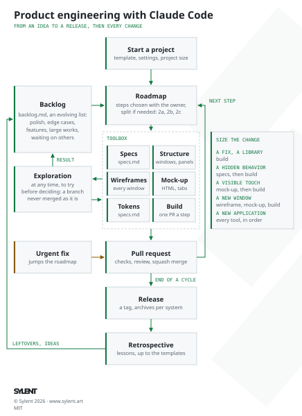

# Process

How a desktop application goes from an idea to a release, then keeps growing, with Claude Code. Its counterparts are [rust-cli-template](https://github.com/sylent-dev/rust-cli-template/blob/main/process.md) for a command-line application and [ts-astro-static-website-template](https://github.com/sylent-dev/ts-astro-static-website-template/blob/main/process.md) for a website: a lesson that applies to every project goes to all three.

The process is not a straight line. Its phases are **tools**, picked for each change according to what it needs: a fix goes straight to the build, a new window goes through its wireframe and mock-up first. What is not being done lives in a **backlog**; what is chosen goes to the **roadmap**, one pull request per step. Each tool ends with something the owner validates, from the cheapest to the most expensive: changing a sentence in the specifications costs less than changing a wireframe, which costs less than changing code.

This file is a living document: after each cycle, update it with what worked and what didn't (see [Retrospective](#retrospective)).



## How it works

1. **Start a project** from the template, and size it with the owner: which tools this project uses, and how far (see [Size the project](#size-the-project)).
2. **The first cycle** takes the application to its first release, through the tools it needs in order: specifications, structure, wireframes, mock-up and design system, build, release, retrospective.
3. **Then the loop**: with the owner, pick from the [backlog](#the-backlog) what comes next, write it in `roadmap.md` as steps, size each change and split it into sub-steps when it helps ([Size a change](#size-a-change)), and run only the tools it needs. A group of steps with a goal (« A history window and Windows support ») is a **cycle**: it ends with its release (a minor or major version) and its retrospective.
4. **Outside the roadmap**, two kinds of work: an [urgent fix](#urgent-fixes) that can't wait, and an [exploration](#explorations) that tries an idea before deciding.

## Size the project

At the setup, Claude Code asks how large the project is and proposes the tools and their depth; the owner decides, and the choice is written at the top of `roadmap.md`. A desktop application always has an interface: the wireframe and the mock-up are never skipped, only made smaller.

| Project | Tools |
|---|---|
| A small utility (one window, a few controls) | Short specifications, one wireframe, a mock-up with two or three styles, a short design system, build, release. |
| An application of several windows or panels | Every tool, in order, for the first cycle. |
| An application used over another program (an overlay, a companion of a game or an editor) | Every tool, in order, with a probe of the riskiest unknown before the wireframe (a window over a fullscreen program, a global hotkey, the clipboard). |

## Size a change

At the start of each step, Claude Code says which tools the change needs, and why, and how many pull requests it expects; the owner may add or remove one. The expected number of pull requests is written with the step in `roadmap.md`, so that the retrospective can compare it with what happened.

| Change | Tools |
|---|---|
| A fix with nothing visible, a dependency | Build. |
| A behavior with nothing visible (a file read, a service called) | Specifications, build. |
| Anything visible (a text, a setting, a notice, a color) | Mock-up, then build; the decision in `specs.md`. |
| A new window or panel | Specifications, structure (where it fits among the others), wireframe, mock-up, build. |
| A touch to the system (a global hotkey, the clipboard, a window over another program) | Specifications, a probe, build, a guide of the test by hand. |
| A new application, a redesign | Every tool, in order. |

Only when it helps, a step is split into sub-steps, one pull request each, each one coherent and tested on its own: a step that needs several tools, or more than one review (for example 4a (specifications and wireframe of a new window), 4b (its mock-up) and 4c (its build)). A small step stays whole, since each pull request also costs a review, the checks and an archive.
When a step turns out larger than sized, stop and size it again with the owner rather than stretching the pull request.

## The backlog

`backlog.md` holds everything noted and not being done: an evolving list, read when the next work is chosen, not at every session (`roadmap.md` stays short).

- **What goes in**: the touches set aside during a step (polish), the edge cases that need thought, the features for later, the large works, and what waits on someone else.
- **One entry per item**: what it is in one sentence, its kind (polish, edge case, feature, large work, waiting), what it depends on, and the date it was noted. Claude Code adds an entry as soon as an idea comes up outside the current step, rather than keeping it only in its memory.
- **From the backlog to the roadmap**: when the roadmap has no step left, or at the end of a cycle, Claude Code proposes the next items with their cost and dependencies; the owner picks; the chosen items leave the backlog and become steps of `roadmap.md`.
- **Polish**: after a release, a series of small touches from the backlog, released together as a patch version, is often worth doing before anything new.
- At each retrospective, the backlog is sorted: what is done or no longer wanted leaves it.

## Urgent fixes

A fix that can't wait (a crash, a security alert, data written to the wrong place) jumps the roadmap:

1. Branch `fix/<short-description>` from `main`, even while a step is in progress (in a worktree if the owner is testing the step in the main folder).
2. The fix, the test that would have caught it, the code review, a pull request opened at once, and a patch release.
3. Once merged, one line in `roadmap.md`, under the step in progress, and the step goes on (rebased on `main`).

## Explorations

An idea that needs trying before deciding (a library, a window over another program, a faster algorithm) is an exploration, not a step. It happens at any time: during a step, when a choice needs trying before it is made (on sylent.art, whether a 3D scene runs on a phone, during the mock-up); or between steps, from an idea of the backlog (the launch videos).

1. A branch `explore/<short-description>`, or a program in the scratchpad: nothing of it is merged as it is.
2. Bounded twice: the owner and Claude Code agree on what it must answer, with a measure when there is one (« does the window stay over the fullscreen game without taking its focus? »), and on how long it may take (one session, two at most). When the time is up, it stops and the decision is taken with what is known: a question still open is an answer too.
3. It ends with its result written down: during a step, the decision goes back to the step (and to `docs/`); otherwise a decision in `docs/technical-choices.md` (kept or set aside, and why), an entry of the backlog, or a step of the roadmap that rebuilds it properly. The branch is then deleted, or kept with a line in the backlog that says why.

The **probe** of a desktop application is the smallest exploration: before the wireframe, the riskiest unknown of the design (a window over a fullscreen program, the focus it must not take, a global hotkey) is tried in half an hour by a throwaway program, in a worktree or the scratchpad, never pushed. On rust-exile-market, it settled what the design could rely on (no focus taken, the clicks kept) before a single block was drawn.

## The tools

Each tool has a **done when**: a list of facts anyone can check, not an impression. When one of them can't be met (no Windows machine to try a step on), the owner decides to go on anyway, and the gap is written in `roadmap.md` or in the backlog, never left unsaid.

| Tool | Use it when | Output | Done when |
|---|---|---|---|
| [Start a project](#start-a-project) | Once, at the start | Repository from the template, its settings, its license, the size of the project | `main` is protected, the package and the executable have their name, the license is the owner's choice, the size of the project is written in `roadmap.md`, and the CI is green on the setup pull request. |
| [Specifications](#specifications) | The application does something new | `specs.md`, the data sources | Every open question is answered; the version has its success criteria; every window and setting it touches has its acceptance scenarios; the [desktop conventions](#desktop-conventions) are answered; the owner has merged them. |
| [Structure](#structure) | The windows, their panels or the settings change | The structure in Excalidraw, written in `specs.md` | The owner has moved the cards and chosen a lead; the parking area is empty (every item placed or sent to the backlog); the chosen lead is in `specs.md`. |
| [Wireframes](#wireframes) | A window or a panel | `docs/wireframes/*.excalidraw` | The owner has approved every window at its smallest size and at its default one (and a wide one if it can be resized), with its title bar, its empty, loading and error states, and the longest language. |
| [Mock-up](#mock-up) | Any visible change | `docs/mockups/*.html` | Every scenario and state of the specifications is shown at the default size of the window and at the owner's, in each language and each theme the application has; no open decision is left on the page; the owner has chosen. |
| [Design system](#design-system) | At the end of a mock-up, a new token | Visual style section of `specs.md` | Every color, size, font and icon of the mock-up is a named token; the mock-up uses only these tokens; the fonts and images have their license. |
| [Build](#build) | Always | One pull request per step | The checks and the CI are green; the acceptance scenarios of the step pass as tests, or are a guide of the test by hand when they need the system; the review notes the owner chose are applied; `specs.md` matches the behavior; the owner has tried it (on every target system for a step that touches the system); the step's box of `roadmap.md` is checked and the pull request merged. |
| [Release](#release) | The end of a cycle, a patch of fixes | Version tag, GitHub release | The version follows the rules of [Release](#release); the archives and `SHA256SUMS.txt` are published; one archive downloaded from the release opens its window, in the language of the system, on each system the owner has; the README explains how to install and use it. |
| [Retrospective](#retrospective) | The end of a cycle, or a tool that went badly | Changes to this file, the templates and the backlog | The success criteria of the version are checked one by one; the planned and actual pull requests are compared; the backlog is sorted; each lesson of `docs/lessons.md` is sorted where it applies (this file, `CLAUDE.md`, the skills, the agents, the templates) or dropped. |

## Start a project

1. Create the repository from [rust-desktop-template](https://github.com/sylent-dev/rust-desktop-template) (see the README, **Start a new project**).
2. Apply the pull request settings: squash merging only, branches deleted once merged.
3. Protect `main` with a ruleset. On a free GitHub account, rulesets only apply to **public** repositories: make the repository public, or keep it private and accept that `main` is not protected.
4. **Choose the license with the owner**, before any code is published: the template writes `MIT OR Apache-2.0`, the default of the Rust ecosystem, which lets anyone ship a closed fork; the GPL 3.0 makes a published fork give its code back. On rust-exile-market, the default stayed until the owner chose the GPL just before the first release: the code published meanwhile stays under the first license.
5. Size the project with the owner ([Size the project](#size-the-project)), and write the tools kept at the top of `roadmap.md`, with the steps of the first cycle.
6. First pull request: rename the package and the executable (`Cargo.toml`, `Cargo.lock`, `APP_NAME` in `src/main.rs`), adapt the README, apply the license, choose a port of its own for the mock-up server (`docs/technical-choices.md`).
7. Open Claude Code in the project folder. Its memory is stored per project: a new session doesn't remember a conversation held in another project. To carry context over, paste a summary of it.
8. Check the connectors: the template turns off the claude.ai connectors (`disableClaudeAiConnectors` in `.claude/settings.json`), whose instructions and tools would be sent with every message. If the project needs one (Claude Docs, Gmail…), remove the setting; `/mcp` lists the servers that are on, and `/context` what fills the context. In the same file, `skillOverrides` hides from the model the skills the project doesn't use (still available with `/<name>`): adjust the list to the project, or use `/skills`.

## Specifications

Goal: agree on **what** the application does before deciding **how**. For a change after the first cycle, only the sections it touches.

1. Describe the idea in a few sentences, then let Claude Code ask its questions, in batches of a few at a time. The usual ones:
   - Who uses it, on which systems, in which languages? Does the program it works with run on each of them (a game with no macOS client rules macOS out)?
   - What is in version 1, and what comes later? What must be easy to add later?
   - Which windows and panels, what does each show, and what does the user do in them?
   - Is it used alone, or next to or over another program (a game, an editor)? Does it need a global hotkey, the clipboard, a window that stays on top?
   - How large is the window, and can it be resized? The title bar of the system, or one of its own?
   - Where does the data come from? Which files does it read or write? Which services does it call?
   - When is this version a success? Two or three facts the owner can check after the release (« it replaces my spreadsheet of prices », « it prices an item in under a second », « it runs on Windows and Linux »).
2. **Check the data sources early**: documentation, rate limits, terms of use, licenses of the images. Read the source code of a service when its limits aren't documented. Record the limits and every risk the owner accepts, with its date, in a note of `docs/` (e.g. `docs/<service>-usage.md`) linked from `roadmap.md`.
3. Write `specs.md`: behavior only (what the user sees, what each control does, edge cases, local files, error handling), the success criteria of the version, the answers to the [desktop conventions](#desktop-conventions), and the requirements that aren't features (the target systems, the smallest and the default size of the window, the speed on a given volume of data, the size of the executable, if they matter).
4. Give each window and setting its **acceptance scenarios**: a starting state, what the user or the system does, and what the window must show, including the errors.

   ```text
   First launch, no settings file     → the window opens at 420 × 640 px, in the language of the system
   An item copied in the game         → the window shows its name and its price within a second
   The price service unreachable      → « Prices unavailable » with the age of the cached prices, and a retry button
   ```

   They are what the owner validates, and each one becomes a test of the build (a test of the state the window draws, apart from the drawing), or a step of a guide of the test by hand when it needs the system or a real service: the specifications and the tests then say the same thing.
5. Write the technical choices with their reasons (and the alternatives rejected) in `docs/technical-choices.md`, then the steps in `roadmap.md`, each small enough for one pull request. `roadmap.md` is read at every session: keep it short, with links to the notes of `docs/`.
6. Open the pull request; the owner reads the files on GitHub (**Files changed**) or in VS Code.

### Desktop conventions

What users expect of any desktop application. The specifications answer each point once, in `specs.md`, and a later change only says when it departs from them:

- **Window**: its smallest and default size, in logical pixels (egui's points), whether it can be resized, and what it shows when it is smaller than designed; its size and position kept from one launch to the next (eframe's `window.ron`), and a window that would open off the screens brought back on one.
- **Title bar**: the one of the system (the template's default), or one of its own (`with_decorations(false)`), whose buttons (close, minimize, move) are drawn from the first wireframes and tried on each system.
- **Keyboard**: the main actions reachable by keyboard; Escape closes a panel; the shortcuts of each system (Ctrl on Linux and Windows, Cmd on macOS). A global hotkey only for an application used over another program, changeable in the settings, and never one the other program needs.
- **Language**: the language of the system until the user picks one in the settings; every text in the translation files (Fluent), never in the code; the numbers and dates written per language; the longest language drawn in the wireframes and the mock-up.
- **Theme**: dark, light, or following the system, decided once; colors that keep their meaning in each theme.
- **Feedback**: every wait longer than a moment shows itself, every error says what happened and what to do, and nothing the user typed is lost when the window closes.
- **Files**: the settings, the data, the cache and the log in the folders of each system (XDG on Linux, `~/Library` on macOS, `%APPDATA%` on Windows), written in `specs.md` (Local files); a file is written atomically, never left half-written; a value this version can't read takes its default without losing the others.
- **Instances**: whether a second launch opens a second window, or brings the first one forward.

## Structure

Goal: agree on how the windows, their panels and the settings fit together, and how one leads to the other, before drawing them.

1. Claude Code draws the structure in Excalidraw (`excalidraw-wireframes` skill): one card per window, panel or group of settings, the current state and **two leads** side by side, a parking area for the items not placed yet and the open questions, so that the owner moves the cards by hand.
2. The owner moves the cards, compares the leads, and chooses; Claude Code redraws the chosen lead, completed, and writes it in `specs.md`.

## Wireframes

Goal: agree on the **layout**, without colors or code, in a format the owner can edit.

The `excalidraw-wireframes` skill (`.claude/skills/`) carries out this phase: its Python helpers write the file and preview it.

1. Claude Code generates an Excalidraw file in `docs/wireframes/` (a script writes the JSON with the helpers of the skill): grayscale, sample data close to real ones, one frame per window, size or state, **one group per block** so that a block moves in one click (double-click a block to edit one of its elements, **Ctrl+Shift+G** to ungroup it).
2. It checks the result with an SVG preview before handing it over.
3. The owner edits it in VS Code with the **Excalidraw** extension (`pomdtr.excalidraw-editor`), or on excalidraw.com (**Open**, then **Save to…**).
4. Iterate: the owner draws their version, Claude Code rearranges it and fills the gaps, the owner draws the next version, and so on. Claude Code commits the owner's version before changing it, so that every iteration stays in the history.
5. Once the main frames are agreed, Claude Code draws the rest under them: other kinds of content, empty, loading and waiting states, errors, the other language.
6. Claude Code writes the agreed layout in `specs.md`.

Sizes are counted in logical pixels, those of egui at a display scale of 1. Start with the smallest window the application supports (e.g. 420 × 640 px, written in `specs.md`): it forces to choose the essential, and the larger sizes then only rearrange the same blocks. Draw the title bar in every frame (the system's as a plain band, or the application's own with its buttons), and the panels that open over the content (settings, help) too.

Working with the file:

- The VS Code extension does **not** save by itself, unlike excalidraw.com: press **Ctrl+S** before asking Claude Code to read the file.
- The extension keeps the drawing in memory and doesn't reload the file when it changes on disk. Before Claude Code rewrites the file, save and close its tab; afterwards, reopen it, and never save the old tab over the new file.

## Mock-up

Goal: choose the style with real content, every scenario and every state, before writing the application.

The `html-mockups` skill (`.claude/skills/`) carries out this phase, from a starting page with the style and decision tabs, and a headless screenshot script.

1. An HTML page in `docs/mockups/`, built from the approved wireframe: every frame of the wireframe becomes a window at its real size, with sample data close to real ones.
2. **Several styles on the same page, 3 or 4**, each with its own colors, fonts, shapes and density, switched with **tabs at the top of the page**. The address keeps the chosen style (e.g. `?theme=slate`) to share it. Each style only sets tokens (CSS variables); the components use them all, so that a style is cheap to add or tweak.
   - The styles explore **new directions** for this application, its users and its subject. [design-journal.md](design-journal.md) records the past experiences: it may inspire one of the styles, never all of them, and nothing in it is a default.
3. The owner picks a style, or mixes two; iterate on it alone, one change at a time (e.g. the main color, then the logo, then the font).
   - **Each open decision gets its own control** on the page, so that the owner compares on screen; once decided, it is removed and the choice is kept: tabs for a few distinct variants (e.g. two button styles, three header variants, five offsets), lists that apply at once for values that combine (e.g. a font per role), sliders for values tuned by eye (e.g. a width, an angle). The address keeps the choices, so that the owner can send them back, an important element is shown alone and in real conditions, and the proposals are numbered once across every series.
   - **Pixel alignments are tuned by eye on the owner's real screen**, with a tab of offsets: the display scale differs from the headless screenshots, which only give the direction.
   - From then on, **the mock-up is the reference** of the interface; the wireframe only fixed the first layout.
4. The mock-up shows windows that egui will draw: it uses only what egui draws well (flat fills, strokes, rounded corners, shadows, the fonts and images the application embeds, simple motions: a hover, a fade, a size that changes over time), never an effect of the browser that egui lacks (a blur behind a panel, a gradient on a text, a complex transition). A resizable window is shown at its default size and at the owner's (asked once, written in `docs/technical-choices.md`): a sentence on three lines in the owner's wider window took four at the default width.
5. Serve the repository root without cache, on the port of the project (`docs/technical-choices.md`), so that the page reaches the files of the repository (icons and logo in `assets/`), even in a sandboxed browser (Flatpak, Snap) that only receives the HTML file, and a reload never mixes old and new files:

   ```sh
   python3 docs/mockups/serve.py <port>
   ```

   then open `http://127.0.0.1:<port>/docs/mockups/<file>.html`, and reload after each change. Two projects on the same port took each other's server over.
6. Claude Code checks its own changes with headless screenshots, kept in its scratchpad, before asking for a review, and exports one large PNG per style to `outputs/` to compare them at a glance. A test that needs extra code runs on a copy of the page, never on the file the owner has open. The screenshots use **Playwright** and its own Chromium, installed once outside the projects (see the `html-mockups` skill): it sees the page once its scripts have settled, reports the errors of the browser console, and works even when Claude Code runs in a sandbox that doesn't see the browsers of the system (VS Code as a Flatpak). It checks the mock-up page only; the application itself is checked with the `egui-screenshots` skill.

## Design system

Goal: write down the visual choices once, so that the application and its future windows stay consistent.

Write them in the visual style section of `specs.md` (or in `docs/design-system.md` when they grow), as named tokens:

- **Colors**: background, bands or panels, borders, text, weak text, the main action, warning, error, success; the colors of the domain (e.g. item rarities). Each color carries a meaning; a meaning is never carried by color alone (a word or an icon goes with it); each theme of the application has its value.
- **Sizes**, in logical pixels: the smallest and default size of the window, the spacing scale, the radius, the heights of a row and of a button, the widths at which the layout changes, and what is cut first (with `…`) when the window is narrow.
- **Typography**: the font per role (text, numbers that line up, titles), its size and weight, the number formatting per language; every font embedded in the executable, under a license that allows it (e.g. SIL Open Font License, with its notice in the archives).
- **Icons and images**: drawn as egui shapes or bundled as images (SVG or PNG) in `assets/`, where they come from, their license (with an `assets/NOTICE.md` for those that aren't under the project license); the icon of the window and of the executable on each system.
- **Shapes and motion**: what is flat, rounded or outlined, the hover effects, the durations and their curves.
- **Tone of the messages**: formal or informal address in each language, length, how errors are worded.

The mock-up is then updated to use exactly these tokens, and the application implements them in one module (its `egui::Style` and its colors), so that changing a color or a size happens in one place. At the end of the phase, add an entry to [design-journal.md](design-journal.md) in the template: the choices kept, the ones rejected, and why.

## Build

For each step of `roadmap.md`, in order:

1. Branch `<type>/<short-description>` from `main`. If the owner isn't testing anything, work in the main folder so that they can follow the changes in VS Code; otherwise, in a Git worktree outside the project.
2. Code, with the tests; then `cargo fmt --all --check`, `cargo clippy --workspace --all-targets --all-features -- -D warnings`, `cargo test --workspace --all-features`.
3. Run the `code-reviewer` subagent: its notes, in French, go to `outputs/`. Claude Code summarizes them; the owner chooses which to apply.
4. Commit (Conventional Commits), push, open the pull request; it checks the step's box in `roadmap.md`.
5. The CI passes; the owner reviews and squash merges; `git pull` on `main`.
6. When a step changes the behavior, update `specs.md` and `roadmap.md` in the same pull request.

Steps that touch the user's system (a global hotkey, the clipboard, a window over another program, the files) are verified on the owner's machine, on every target system, as early as possible in the roadmap. When a bug reaches the owner that a test could have caught, the fix adds the test.

What the tests cover, at least:

- Every acceptance scenario of `specs.md` touched by the step, as a test of the state the window draws (what it shows, what a click changes), with the logic apart from egui, so that a test never needs a window.
- The rules of [Desktop conventions](#desktop-conventions) that the step touches: the settings written atomically and read back, a value that can't be read taking its default, every message present in every language (the test of `src/i18n.rs`).
- What needs the system or a real service (a hotkey, the clipboard, the focus, the window over another program): a guide of the test by hand in `docs/tests/linux/` or `docs/tests/windows/` (`hand-test-guides` skill), run again before each release.
- A visual change: a few screenshots of the window concerned (`egui-screenshots` skill), compared with the mock-up, then deleted.
- A requirement of speed written in `specs.md` is measured on its volume of data before the step is done, not after the release.

## Release

1. Executable name, the icon of the window and of the executable, README (how to install, how to use it, what it calls on the network and its risks, per system).
2. Choose the version ([Semantic Versioning](https://semver.org/)): **patch** for fixes only; **minor** for a new window, setting or feature that changes nothing existing; **major** (or minor before 1.0) for a breaking change: a settings file that must be migrated, a setting removed, a file moved or a hotkey changed by default. The `!` commits of the cycle (Conventional Commits) point to the breaking changes.
3. Before the first release, a **quality review of the whole repository, area by area** (a step of `roadmap.md`): `code-reviewer` in its area mode, one pass per area at once, each told what the others read and given the results of Clippy and of the tests run once before them, against SOLID, DRY and KISS, a design pattern only where it removes a real difficulty. Its findings are split into pull requests: the fixes of behavior first, then the tests, then what needs a mock-up, the moves last. On rust-exile-market it found what the reviews of the branches couldn't (a rule that held on one path of three, tests that no longer tested what their name said) and was worth four pull requests; after the first release, one at each large step rather than one at the end.
4. Follow `docs/releases.md`: the security audit (`security-auditor`), the Dependabot pull requests reviewed (`dependency-reviewer`), the guides of `docs/tests/` run again, the notes of the version, a build by hand of every system, then the tag.
5. Reread the release notes on GitHub: a short summary at the top for the users, and the breaking changes, with what to do, first.
6. Download one archive from the release, check it against `SHA256SUMS.txt`, and open it on each system the owner has: the window opens, in the language of the system, with its icon, and its log names the version. The release is what the users get, not the build of the owner's machine.
7. Commitments to third parties (e.g. tell a data provider once the releases reach a number of downloads).

A release that went wrong is not deleted once someone may have downloaded it: the fix comes as the next patch version.

After the first release, the roadmap of the template brings a **donation method** if the owner wants one: a link in the README, on the site, and a discreet one in the application (mock-up first). Before opening a new donation page, check what the payment service shows the donors: on Ko-fi, a personal PayPal account shows the owner's legal name and email, while Stripe alone shows the public name chosen. One page per application, so that each page tells what its application brings.

## Retrospective

Often, like the refactoring, rather than one big one at the end: the first right after the first release, while the lessons are fresh and the users' reports take time to come; the next after the polish that follows, with those reports; then at the end of each cycle, or after any tool that went badly:

1. Check the success criteria of the version, one by one: met, not met (and why), or not measurable yet (and when it will be). A criterion not met becomes a backlog entry, or is dropped on purpose.
2. Compare the pull requests expected for each step with those it took: what took longer than expected? What had to be redone? What did the owner like most? Did the models recommended for the steps hold (`roadmap.md`, Models)?
3. Sort the lessons of `docs/lessons.md` one by one with the owner, by batches of about fifteen, the decision written on each line: into this file, `CLAUDE.md`, a skill or an agent of this project, into the templates (this one, and the others when the lesson holds for them too), or dropped.
4. Sort the backlog: the leftovers and the ideas of the cycle go in, what is done or no longer wanted goes out.
5. Read Claude Code's memory of the project: a rule or a preference that holds for the whole project moves to `CLAUDE.md` or this file, where the next sessions and the templates find it.
6. Update this file, and the template (`CLAUDE.md`, `README.md`, the skills) when the lesson applies to every project, and the other templates when it applies to them too: a lesson about the process goes to [Lessons learned](#lessons-learned), a trap of a tool or of the environment to [Known pitfalls](#known-pitfalls).

## Lessons learned

The lessons about the process, from the previous projects: each one changed a rule of this file.

| Project | Lesson |
|---|---|
| rust-exile-market | Coded mock-ups were never exactly what the owner wanted: start with editable wireframes. |
| rust-exile-market | Read the terms of use of every data source during the specifications: a forbidden API changes the scope of version 1. |
| rust-exile-market | The owner draws, Claude Code rearranges and completes: the wireframe iterations made the interface personal. |
| rust-exile-market | Mock-ups got much better once the layout was settled: one question per phase (layout, then style). |
| rust-exile-market | Three styles on one page with tabs made the choice easy; the main color stays white so that colors keep their meaning (item rarities). |
| rust-exile-market | One tab group per open decision, removed once decided, turned about a hundred small decisions into quick on-screen comparisons. |
| rust-exile-market | Pixel offsets measured on headless screenshots were wrong on the owner's scaled screen: tune them by eye with a tab of values. |
| rust-exile-market | The wireframe and mock-up phases worked so well that they became the `excalidraw-wireframes` and `html-mockups` skills, with their scripts. |
| rust-exile-market | A probe of half an hour (an X11 window over the fullscreen game) settled what the design could rely on before the wireframe: the riskiest unknown is tried first. |
| rust-exile-market | The license was left at the template's default until just before the first release, when the owner wanted the GPL: it is chosen when the project starts. |
| rust-exile-market | The first quality review of the whole repository, area by area, found what the reviews of the branches couldn't, and was worth four pull requests: it is a step before the first release. |
| rust-exile-market | A retrospective right after the first release, while the lessons were fresh, gave the template to another project at once: retrospectives often, rather than one at the end. |
| sylent.art | The structure of the content came after the build, and the addresses changed twice: sketch the structure in Excalidraw during the specifications, cards moved by hand. |
| sylent.art | Bold variants showed the owner what they wanted: they couldn't have said « sober or spectacular » before seeing them. |
| sylent.art | The checks born from a bug kept it from coming back: when a bug reaches the owner, the fix adds the test. |
| sylent.art | A worktree outside the folder open in VS Code is invisible to the owner: work on the branch in the main folder while they test nothing there. |
| sylent.art | Open a pull request only once the owner has seen the result (the review applied, the drawing looked at). |
| sylent.art | The classification of the offers ran as a mini-cycle of its own (specifications, then wireframe and mock-up, then build): the unit of the process is the change, not the project. |
| sylent.art | Ideas kept only in Claude Code's memory are easily lost between sessions, and some wait on other people: a `backlog.md` holds them, and the roadmap only what is chosen. |
| stepwise | Twenty fixed boards of fonts couldn't show the combinations: one list per role at the top of the page, applied at once and kept in the address, made the mock-up something the owner tunes themselves. |
| stepwise | Two series of proposals, one numbered and one lettered, led to a misunderstanding on "the B" and a whole iteration lost: number the proposals once, across every series. |

## Known pitfalls

The traps of the tools and of the environment met on the previous projects, with their fix. They don't change the process; they save a session.

| Project | Pitfall and fix |
|---|---|
| rust-exile-market | A Flatpak browser only receives the opened file: serve the repository with `python3 -m http.server`. |
| rust-exile-market | In the VS Code Flatpak, `~/.cargo/bin` is not on the `PATH` of the terminal: prepend it. |
| rust-exile-market | On a free GitHub account, rulesets only protect public repositories. |
| rust-exile-market | The VS Code Excalidraw extension neither autosaves nor reloads a file changed on disk: save, close, reopen. |
| rust-exile-market | Under Wayland, a window can't place itself nor read its position: the template runs on X11 (XWayland). The screenshot tools of the desktop gave a blank image or captured another window: the application takes its own (`egui-screenshots` skill). |
| sylent.art | Two mock-up servers of two projects on the same port broke the owner's page: one port per project, a server without cache. |
| stepwise | Claude Code in VS Code installed as a Flatpak couldn't see Firefox, so the drawings of a mock-up were checked without their page; Playwright and its own Chromium now take the screenshots and report the errors of the browser console. |
